# Fotos propostas — 17 de outubro de 2026

Seleção visual assistida por IA, **aprovada pelo usuário em 17/10/2026**. As categorias abaixo foram aplicadas às fotos novas. Duas fotos sem proposta específica mantêm `unknown`. As fotos anteriores e suas categorias foram preservadas.

A aprovação está registrada em `sources/editorial/human-review-2026-10-17.json`. Clique na miniatura para abrir o arquivo completo; a observação mantém a identificação e o autor originais.

| Ficha / espécie fotografada | Foto CC0 | Categorias propostas / legenda |
| --- | --- | --- |
| Guriri <i>Allagoptera arenaria</i> | [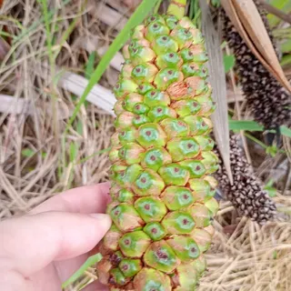](../assets/plants/inat-500657901.jpeg) [Lucas Rodrigues](https://www.inaturalist.org/observations/278821932) · 500657901 | **Fruto** Frutos agrupados em uma espiga compacta. |
| Guriri <i>Allagoptera arenaria</i> | [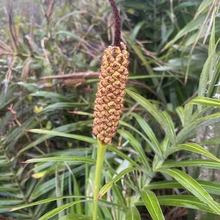](../assets/plants/inat-677242396.jpg) [rebecca bachman](https://www.inaturalist.org/observations/370703702) · 677242396 | **Flor** Inflorescência entre as folhas da palmeira. |
| Antúrios nativos <i>Anthurium pentaphyllum</i> | [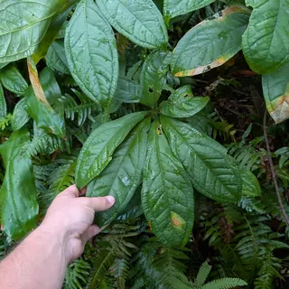](../assets/plants/inat-668742274.jpg) [Damien Wallace](https://www.inaturalist.org/observations/366244236) · 668742274 | **Folha** Folha dividida em folíolos, uma das formas presentes neste grupo. |
| Antúrios nativos <i>Anthurium scandens</i> | [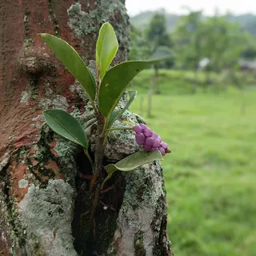](../assets/plants/inat-42075103.jpg) [Zoltán Stekkelpak](https://www.inaturalist.org/observations/27067291) · 42075103 | **Planta inteira, Fruto** Planta sobre o tronco, com frutos agrupados no espádice. |
| Antúrios nativos <i>Anthurium scandens</i> | [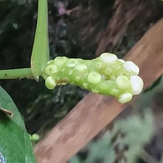](../assets/plants/inat-343736824.jpeg) [andrew2285](https://www.inaturalist.org/observations/195395090) · 343736824 | **Fruto** Detalhe dos frutos claros e arredondados. |
| Antúrios nativos <i>Anthurium scandens</i> | [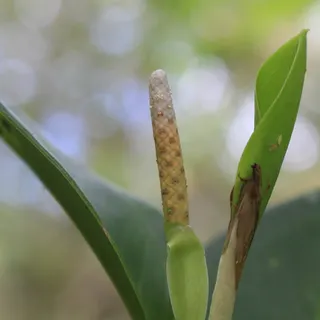](../assets/plants/inat-117906745.jpeg) [Jake Rehage](https://www.inaturalist.org/observations/72329676) · 117906745 | **Flor** Espádice e espata vistos de perto. |
| Gravatá <i>Bromelia antiacantha</i> | [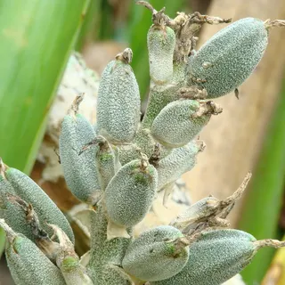](../assets/plants/inat-228015763.jpeg) [Paula Romano](https://www.inaturalist.org/observations/133830175) · 228015763 | **Fruto** Detalhe dos frutos ainda verdes. |
| Feijão-da-praia <i>Canavalia rosea</i> | [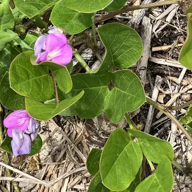](../assets/plants/inat-671334398.jpg) [monkeyjodey](https://www.inaturalist.org/observations/367600850) · 671334398 | **Flor, Folha** Flores rosadas e folhas com três folíolos sobre a areia. |
| Feijão-da-praia <i>Canavalia rosea</i> | [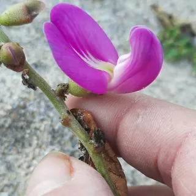](../assets/plants/inat-340183203.jpeg) [peakaytea](https://www.inaturalist.org/observations/193640489) · 340183203 | **Flor** Flor vista de frente para comparar o formato das pétalas. |
| Feijão-da-praia <i>Canavalia rosea</i> | [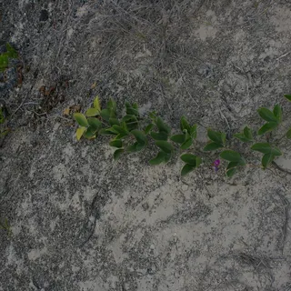](../assets/plants/inat-120678383.jpeg) [Don Johnston](https://www.inaturalist.org/observations/73879615) · 120678383 | **Planta inteira** Ramo rastejante mostrando como a planta se espalha sobre a areia. |
| Feijão-da-praia <i>Canavalia rosea</i> | [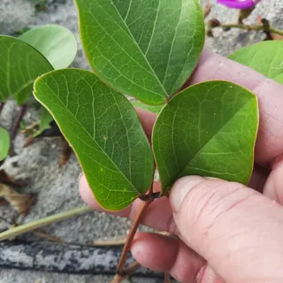](../assets/plants/inat-340224512.jpeg) [peakaytea](https://www.inaturalist.org/observations/193640489) · 340224512 | **Folha** Uma folha completa, com seus três folíolos. |
| Paineira <i>Ceiba speciosa</i> | [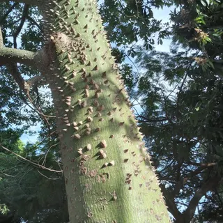](../assets/plants/inat-321512495.jpg) [Cecilia Arguelo](https://www.inaturalist.org/observations/184207069) · 321512495 | **Casca** Tronco esverdeado com acúleos, as projeções pontiagudas da casca. |
| Mandacaru-da-restinga <i>Cereus fernambucensis</i> | [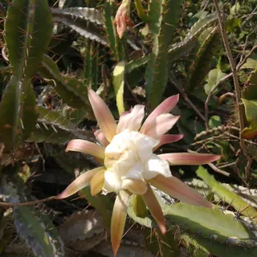](../assets/plants/inat-161010806.jpeg) [Lucas Rodrigues](https://www.inaturalist.org/observations/96878815) · 161010806 | **Flor** Flor aberta junto aos ramos do cacto. |
| Mandacaru-da-restinga <i>Cereus fernambucensis</i> | [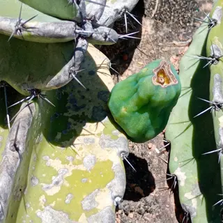](../assets/plants/inat-451808567.jpeg) [Lucas Rodrigues](https://www.inaturalist.org/observations/252392079) · 451808567 | **Fruto** Fruto verde preso ao caule, entre as fileiras de espinhos. |
| Clúsia <i>Clusia fluminensis</i> | [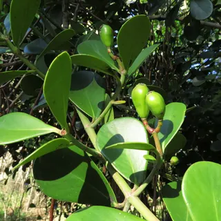](../assets/plants/inat-236094533.jpeg) [Paula Romano](https://www.inaturalist.org/observations/138163391) · 236094533 | **Fruto, Folha** Frutos verdes e folhas grossas em pares. |
| Mangue-de-botão <i>Conocarpus erectus</i> | [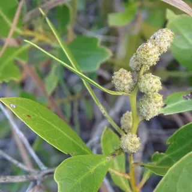](../assets/plants/inat-251174213.jpeg) [Michael W Belitz](https://www.inaturalist.org/observations/146134788) · 251174213 | **Flor, Folha** Pequenas flores reunidas em cabeças arredondadas. |
| Mangue-de-botão <i>Conocarpus erectus</i> | [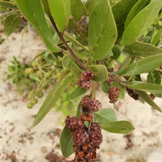](../assets/plants/inat-208226148.jpeg) [Yolanda M. Leon](https://www.inaturalist.org/observations/122948045) · 208226148 | **Fruto** Conjuntos de frutos castanhos, semelhantes a botões. |
| Mangue-de-botão <i>Conocarpus erectus</i> | [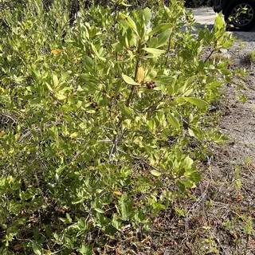](../assets/plants/inat-612246689.jpg) [monkeyjodey](https://www.inaturalist.org/observations/336865521) · 612246689 | **Planta inteira** Vista do arbusto e de sua ramificação. |
| Cana-do-brejo <i>Costus spiralis</i> | [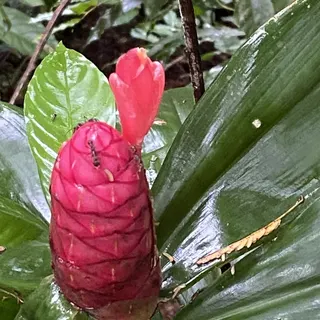](../assets/plants/inat-104911507.jpg) [Jean-Paul Boerekamps](https://www.inaturalist.org/observations/65204641) · 104911507 | **Flor** Flor tubular saindo entre as brácteas vermelhas. |
| Cana-do-brejo <i>Costus spiralis</i> | [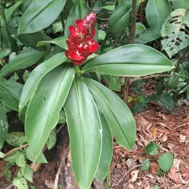](../assets/plants/inat-481562276.jpeg) [Hugo Saulino](https://www.inaturalist.org/observations/267938781) · 481562276 | **Planta inteira, Folha** Folhas distribuídas ao redor do caule e inflorescência na ponta. |
| Rabo-de-bugio <i>Dalbergia ecastaphyllum</i> | [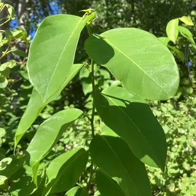](../assets/plants/inat-332865961.jpg) [Laurie Brooks](https://www.inaturalist.org/observations/189944109) · 332865961 | **Folha** Folhas largas, cada uma com um único folíolo. |
| Rabo-de-bugio <i>Dalbergia ecastaphyllum</i> | [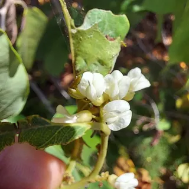](../assets/plants/inat-659295137.jpg) [Adam Pitcher](https://www.inaturalist.org/observations/361277610) · 659295137 | **Flor** Detalhe das pequenas flores claras. |
| Rabo-de-bugio <i>Dalbergia ecastaphyllum</i> | [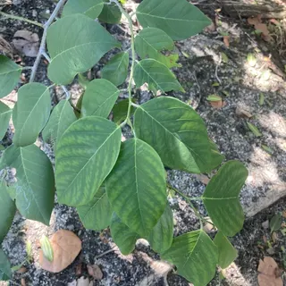](../assets/plants/inat-177712352.jpg) [Jade Fortnash](https://www.inaturalist.org/observations/105857815) · 177712352 | **Fruto, Folha** Frutos achatados ainda presos ao ramo. |
| Rabo-de-bugio <i>Dalbergia ecastaphyllum</i> | [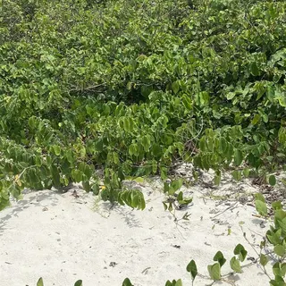](../assets/plants/inat-464519439.jpg) [Paulo Mascaretti](https://www.inaturalist.org/observations/258848578) · 464519439 | **Planta inteira** Ramos espalhando-se pela vegetação da restinga. |
| Grumixama <i>Eugenia brasiliensis</i> | [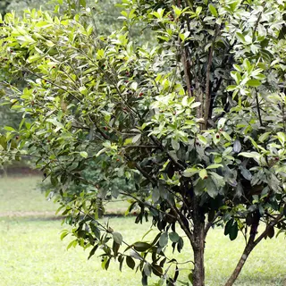](../assets/plants/inat-596458352.jpg) [Paula Romano](https://www.inaturalist.org/observations/329088767) · 596458352 | **Planta inteira** Vista da árvore, com o tronco e o contorno da copa. |
| Palmito-juçara <i>Euterpe edulis</i> | [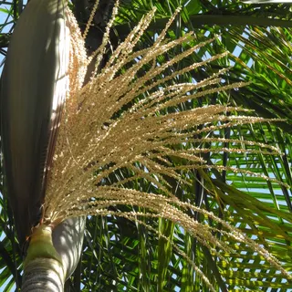](../assets/plants/inat-145828117.jpeg) [Paula Romano](https://www.inaturalist.org/observations/88388403) · 145828117 | **Flor** Inflorescência ramificada abaixo da copa. |
| Palmito-juçara <i>Euterpe edulis</i> | [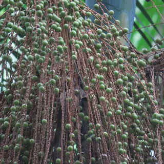](../assets/plants/inat-389604637.jpeg) [Paula Romano](https://www.inaturalist.org/observations/220080419) · 389604637 | **Fruto** Cacho com frutos arredondados em diferentes estágios. |
| Salsa-da-praia <i>Ipomoea pes-caprae</i> | [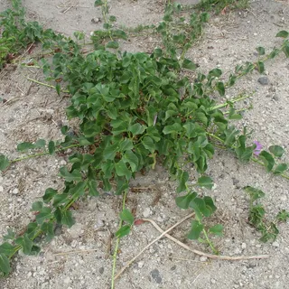](../assets/plants/inat-338766518.jpeg) [dune_ninja](https://www.inaturalist.org/observations/192913722) · 338766518 | **Planta inteira** Ramos rastejantes se espalhando sobre a areia. |
| Salsa-da-praia <i>Ipomoea pes-caprae</i> | [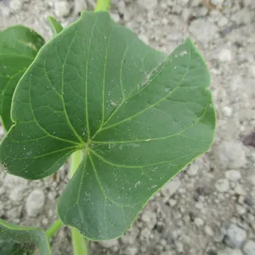](../assets/plants/inat-338766524.jpeg) [dune_ninja](https://www.inaturalist.org/observations/192913722) · 338766524 | **Folha** Folha com reentrância na ponta e nervuras bem visíveis. |
| Mangue-branco <i>Laguncularia racemosa</i> | [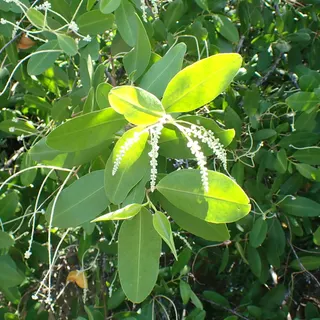](../assets/plants/inat-456338735.jpg) [Jean-Paul Boerekamps](https://www.inaturalist.org/observations/252279534) · 456338735 | **Flor, Folha** Ramo com folhas em pares e pequenas flores claras. |
| Mangue-branco <i>Laguncularia racemosa</i> | [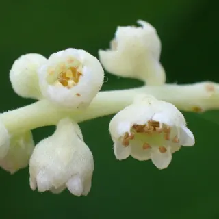](../assets/plants/inat-456338769.jpg) [Jean-Paul Boerekamps](https://www.inaturalist.org/observations/252279534) · 456338769 | **Flor** Flores ampliadas para observar sua forma. |
| Mangue-branco <i>Laguncularia racemosa</i> | [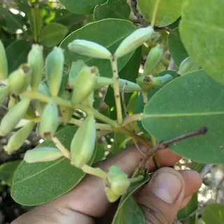](../assets/plants/inat-595572466.jpg) [Augusto Olmos Mercado](https://www.inaturalist.org/observations/328644303) · 595572466 | **Fruto** Detalhe dos frutos verdes alongados. |
| Mangue-branco <i>Laguncularia racemosa</i> | [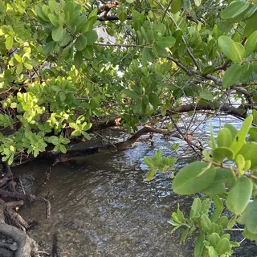](../assets/plants/inat-107296233.jpg) [Jade Fortnash](https://www.inaturalist.org/observations/66544222) · 107296233 | **Sem proposta de categoria** Ramos sobre a água, mostrando a posição da planta no manguezal. |
| Maracujá-doce <i>Passiflora alata</i> | [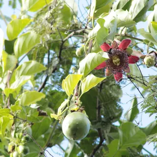](../assets/plants/inat-520912108.jpg) [Paula Romano](https://www.inaturalist.org/observations/289617586) · 520912108 | **Flor, Fruto, Folha** Flor aberta, fruto verde e folhas no mesmo ramo. |
| Maracujá <i>Passiflora edulis</i> | [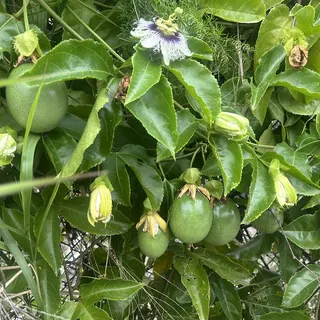](../assets/plants/inat-652813955.jpg) [Yi-fan翊凡](https://www.inaturalist.org/observations/357892280) · 652813955 | **Fruto, Folha** Frutos ainda verdes entre as folhas da trepadeira. |
| Maracujá <i>Passiflora edulis</i> | [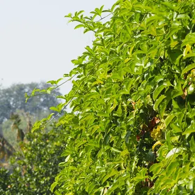](../assets/plants/inat-30424315.jpeg) [葉子](https://www.inaturalist.org/observations/19745548) · 30424315 | **Planta inteira** Vista da trepadeira cobrindo seu suporte. |
| Pau-brasil <i>Paubrasilia echinata</i> | [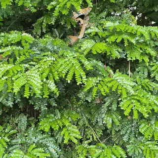](../assets/plants/inat-628956656.jpg) [Gabriel Cardoso Fialho](https://www.inaturalist.org/observations/345147803) · 628956656 | **Folha** Folhas divididas em numerosos folíolos. |
| Pau-brasil <i>Paubrasilia echinata</i> | [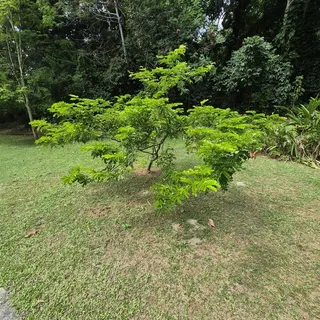](../assets/plants/inat-618210200.jpg) [Gabriel Cardoso Fialho](https://www.inaturalist.org/observations/339795604) · 618210200 | **Planta inteira** Árvore jovem, mostrando a ramificação e o contorno da copa. |
| Filodendros nativos <i>Philodendron bipennifolium</i> | [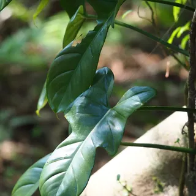](../assets/plants/inat-264791225.jpeg) [葉子](https://www.inaturalist.org/observations/153317947) · 264791225 | **Folha** Folha recortada, para comparar com as folhas inteiras de outros membros do grupo. |
| Filodendros nativos <i>Philodendron cordatum</i> | [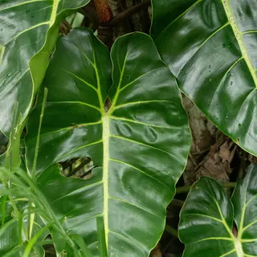](../assets/plants/inat-618059118.jpg) [filipeprates](https://www.inaturalist.org/observations/339722457) · 618059118 | **Folha** Folha larga com nervuras destacadas. |
| Filodendros nativos <i>Philodendron cordatum</i> | [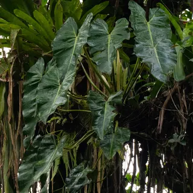](../assets/plants/inat-740706523.jpg) [filipeprates](https://www.inaturalist.org/observations/403428695) · 740706523 | **Planta inteira, Raiz** Planta apoiada no tronco, com raízes pendentes. |
| Pimenta-de-macaco <i>Piper arboreum</i> | [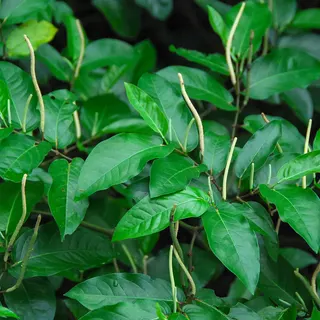](../assets/plants/inat-208135364.jpg) [Whaldener Endo](https://www.inaturalist.org/observations/122898127) · 208135364 | **Flor, Folha** Ramos com folhas alongadas e espigas estreitas. |
| Quaresmeira <i>Pleroma granulosum</i> | [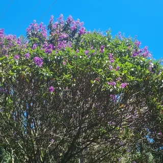](../assets/plants/inat-465747805.jpeg) [Kauã Neves](https://www.inaturalist.org/observations/259452956) · 465747805 | **Planta inteira, Flor** Vista da árvore florida e do contorno da copa. |
| Cambucá <i>Plinia edulis</i> | [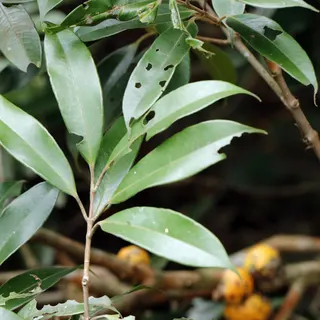](../assets/plants/inat-637608482.jpg) [Paula Romano](https://www.inaturalist.org/observations/349529106) · 637608482 | **Folha** Detalhe de um ramo com folhas em pares. |
| Araçá <i>Psidium cattleyanum</i> | [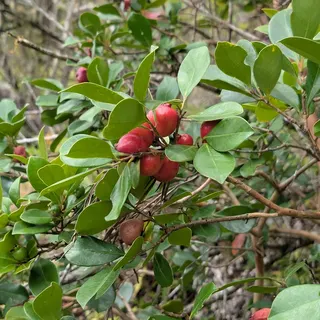](../assets/plants/inat-699965383.jpg) [Damien Wallace](https://www.inaturalist.org/observations/382485685) · 699965383 | **Fruto** Araçás vermelhos ainda presos aos ramos. |
| Araçá <i>Psidium cattleyanum</i> | [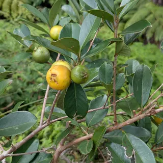](../assets/plants/inat-553488433.jpg) [Damien Wallace](https://www.inaturalist.org/observations/306895491) · 553488433 | **Fruto, Folha** Frutos amarelos, outra coloração presente na espécie. |
| Araçá <i>Psidium cattleyanum</i> | [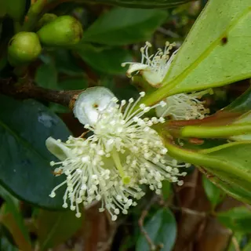](../assets/plants/inat-11217062.jpg) [Peter de Lange](https://www.inaturalist.org/observations/8424378) · 11217062 | **Flor** Flor branca com numerosos estames. |
| Mangue-vermelho <i>Rhizophora mangle</i> | [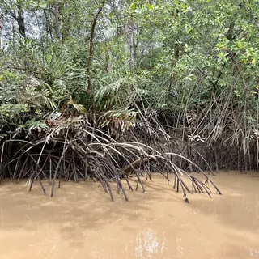](../assets/plants/inat-223108952.jpg) [Irene](https://www.inaturalist.org/observations/131132414) · 223108952 | **Raiz** Raízes arqueadas de sustentação na margem do manguezal. |
| Mangue-vermelho <i>Rhizophora mangle</i> | [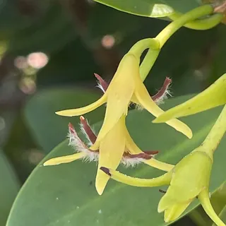](../assets/plants/inat-160306622.jpg) [Ingolf Askevold](https://www.inaturalist.org/observations/96488919) · 160306622 | **Flor** Detalhe das flores entre as folhas. |
| Mangue-vermelho <i>Rhizophora mangle</i> | [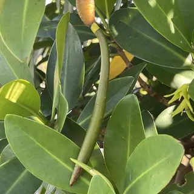](../assets/plants/inat-160307908.jpg) [Ingolf Askevold](https://www.inaturalist.org/observations/96488919) · 160307908 | **Sem proposta de categoria** Propágulo alongado ainda preso à planta: uma plântula em desenvolvimento. |
| Mangue-vermelho <i>Rhizophora mangle</i> |  [Daniel Estabrooks](https://www.inaturalist.org/observations/364024371) · 664522272 | **Planta inteira** Indivíduo jovem mostrando copa, troncos e raízes. |
| Mangue-da-praia <i>Scaevola plumieri</i> |  [Kristen Francis](https://www.inaturalist.org/observations/358298429) · 653610252 | **Flor** Flores em forma de leque, abertas para um só lado. |
| Mangue-da-praia <i>Scaevola plumieri</i> |  [Kristen Francis](https://www.inaturalist.org/observations/358298429) · 653610296 | **Fruto** Detalhe dos frutos escuros. |
| Mangue-da-praia <i>Scaevola plumieri</i> |  [Lucas Rodrigues](https://www.inaturalist.org/observations/222858643) · 394825835 | **Planta inteira** Porte do arbusto na vegetação à beira da praia. |
| Pau-brasil <i>Paubrasilia echinata</i> |  [Gabriel Cardoso Fialho](https://www.inaturalist.org/observations/326887779) · 592117130 | **Fruto** Frutos verdes achatados, com pequenas projeções na superfície. |
| Pau-brasil <i>Paubrasilia echinata</i> |  [Gabriel Cardoso Fialho](https://www.inaturalist.org/observations/321441294) · 581333495 | **Flor** Inflorescências amarelas entre as folhas da copa. |
| Aroeira-vermelha <i>Schinus terebinthifolia</i> |  [Damien Wallace](https://www.inaturalist.org/observations/254765528) · 456408896 | **Fruto** Cacho de pequenos frutos vermelhos. |
| Pitanga <i>Eugenia uniflora</i> |  [Jean Wickert](https://www.inaturalist.org/observations/307856355) · 555344604 | **Planta inteira** Vista da árvore mostrando os troncos e o contorno da copa. |
| Jerivá <i>Syagrus romanzoffiana</i> |  [Hugo Hulsberg](https://www.inaturalist.org/observations/102169880) · 170738115 | **Fruto** Cacho de frutos ainda verdes abaixo da copa. |
| Jerivá <i>Syagrus romanzoffiana</i> |  [filipeprates](https://www.inaturalist.org/observations/254919442) · 456718287 | **Flor** Inflorescência aberta junto às bases das folhas. |
| Jerivá <i>Syagrus romanzoffiana</i> |  [Luis Capeletti](https://www.inaturalist.org/observations/275276998) · 494691898 | **Planta inteira** Palmeira inteira vista à distância, com seu tronco e copa. |
